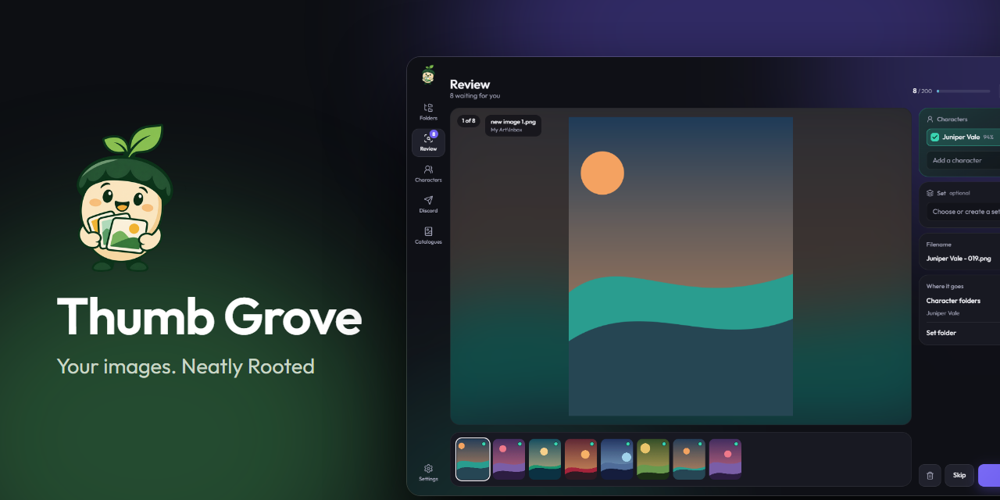
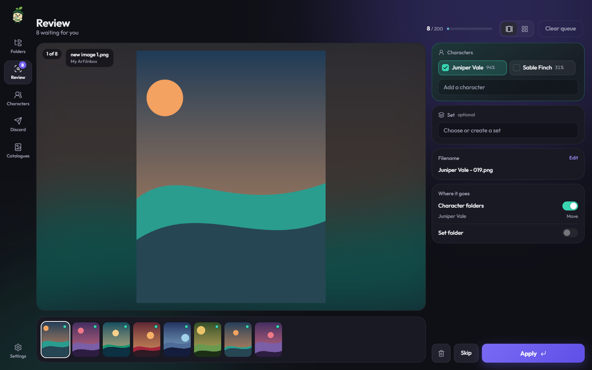
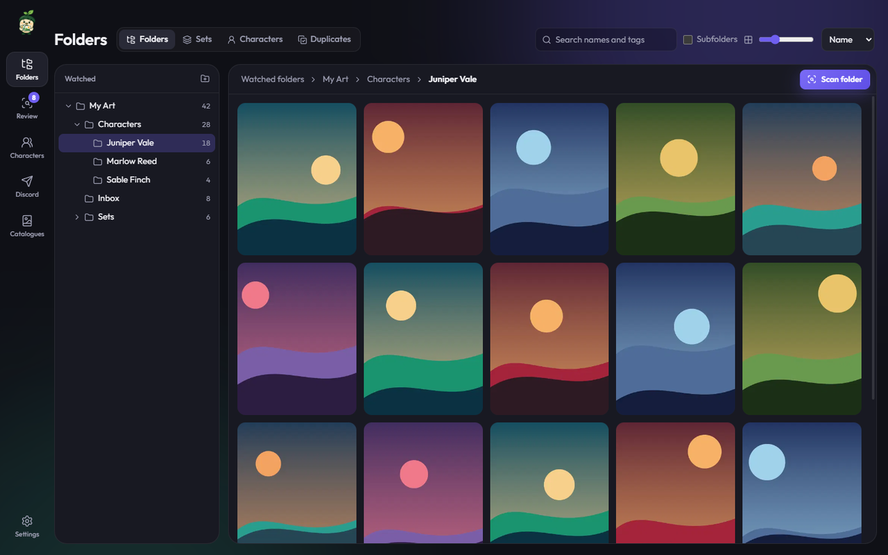
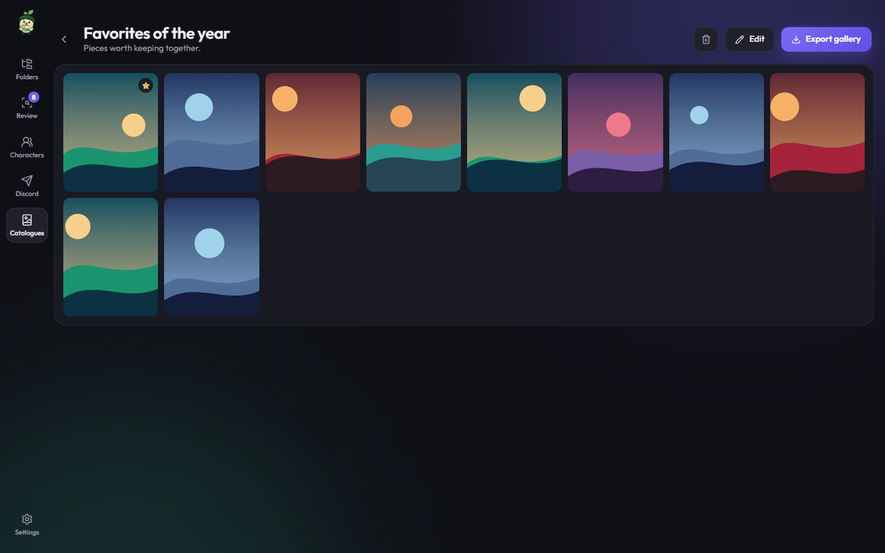
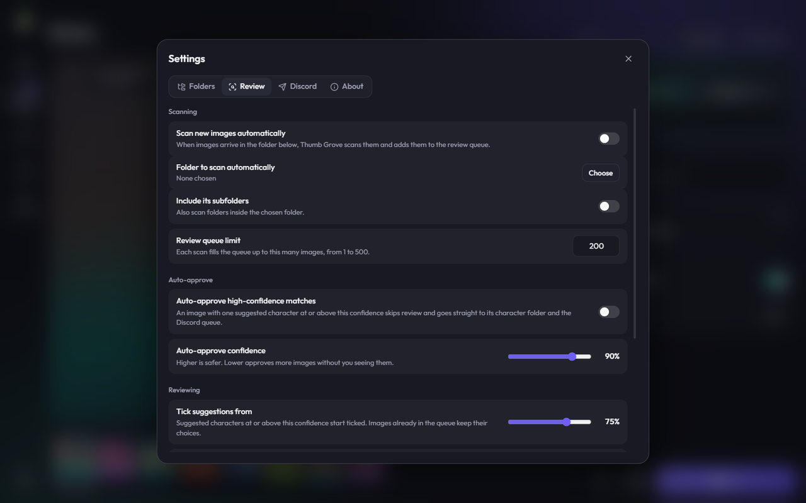

<p align="center">
  
</p>

<p align="center">
  <a href="https://github.com/mkwinfr/Thumbgrove/releases"></a>
</p>

<p align="center">
  <a href="https://github.com/mkwinfr/Thumbgrove/releases"></a>
  
  
</p>

Thumb Grove is a Windows app for large image collections. It watches your folders, suggests which character each new image shows, sorts images into character and set folders once you approve them, and can post them to your own Discord server.

Your images stay on your computer. Thumb Grove indexes them where they are, and only moves a file when you approve it or ask it to.

<p align="center">
  
</p>

## Features

- **Watched folders:** new and changed images are picked up automatically, with thumbnails that stay fast across thousands of files.
- **Review:** check each suggestion one at a time or in a grid, then send images to their character and set folders in a batch. You can undo an apply.
- **Character recognition:** suggestions run on your own computer, using your graphics card when it can.
- **Auto-approve:** optional, and off by default. High-confidence matches skip review, and you can see and undo each one afterward.
- **Learning from corrections:** if you replace the same suggestion with the same character twice, Thumb Grove suggests your choice from then on.
- **Discord posting:** post images to a thread for each character or set, and skip images already on the server.
- **Library tools:** edit, rename, and merge characters and sets, add tags and favorites, and find duplicates.
- **Catalogues:** build your own collections in any order, then export one as a gallery that opens in any browser, even offline.

Thumb Grove reads JPG, PNG, WebP, GIF, and BMP files.

<table>
  <tr>
    <td width="33%"></td>
    <td width="33%"></td>
    <td width="33%"></td>
  </tr>
  <tr>
    <td align="center">Browse your folders</td>
    <td align="center">Build catalogues</td>
    <td align="center">Choose how it works</td>
  </tr>
</table>

Screenshots use generated art and made-up characters.

## Install

> [!NOTE]
> Thumb Grove is an early pre-release, and has only been tested on one PC so far. Please report problems on the [Issues page](https://github.com/mkwinfr/Thumbgrove/issues).

You need 64-bit Windows.

1. Download `Thumb-Grove-Setup-<version>.exe` from the [Releases page](https://github.com/mkwinfr/Thumbgrove/releases) and run it. It installs for your user only, so it doesn't need administrator rights.
2. If Windows SmartScreen warns you, choose **More info**, then **Run anyway**. The warning appears because the installer isn't code signed.

To update, run the new installer over your current version. Your library and settings stay in place.

## Get started

1. Open Thumb Grove and choose a folder to watch.
2. Open a folder and choose **Scan folder**. The first scan offers to download the recognition model, which is about 468 MB and is only downloaded once.
3. Go to the Review page, check the suggestions, and apply them.

Applied images go to `Characters` and `Sets` folders inside your first watched folder. You can choose different folders in **Settings → Folders**, as long as they're inside a watched folder.

## Connect Discord

Discord is optional. Each person uses their own bot, and everything here starts empty.

1. Create an application in the [Discord Developer Portal](https://discord.com/developers/applications), open its **Bot** page, and copy the bot token. Treat this token like a password.
2. On the **OAuth2** page, generate an invite link with the `bot` scope and these permissions, then use it to add the bot to your server:
   - View Channels
   - Send Messages
   - Send Messages in Threads
   - Create Public Threads
   - Attach Files
   - Read Message History
3. In Discord, turn on **Developer Mode** in the Advanced settings. Then right-click your server and choose **Copy Server ID**.
4. In Thumb Grove, open **Settings → Discord**, enter the token and server ID, and choose **Save and connect**.
5. Choose a channel for character threads and one for set threads. Each can be a text, forum, or media channel.

To check for images other people have already posted, also turn on **Message Content Intent** on the bot's page in the Developer Portal. Without it, Discord hides the contents of those posts from the bot.

## Privacy and your data

- **Internet use:** Thumb Grove only goes online to talk to Discord and to download the recognition model once. Recognition runs on your computer, and your images are never uploaded for it. Images only reach Discord when you post them.
- **Bot token:** it's encrypted on your computer, and is hidden from the error log.
- **Your files:** moves never overwrite an existing file. A file with the same name gets a number added.
- **Where data lives:** your library, settings, and token are in `%APPDATA%\Thumb Grove`. Before a database upgrade, Thumb Grove saves a backup there and keeps the last five.
- **Uninstalling:** this deletes that data folder, including your token and the downloaded model, so a later install starts from scratch. Your images aren't touched.

## Limits

- Thumb Grove only runs on Windows.
- Recognition uses [WD SwinV2 Tagger v3](https://huggingface.co/SmilingWolf/wd-swinv2-tagger-v3) by SmilingWolf, an image tagger built for anime-style art. It can only name characters it was trained on, and its suggestions can be wrong, so keep auto-approve off until you trust the results.

## Build from source

You need Windows and [Node.js](https://nodejs.org/) 24.

```bash
npm install
```

```bash
npm run dev
```

To run the tests and the type check:

```bash
npm test
```

```bash
npm run typecheck
```

To build the installer and a portable version in `dist`:

```bash
npm run dist
```

[RELEASING.md](RELEASING.md) has the release steps, and [ROADMAP.md](ROADMAP.md) has the plan for distribution.

## License

No license has been chosen yet, so all rights are reserved for now.
